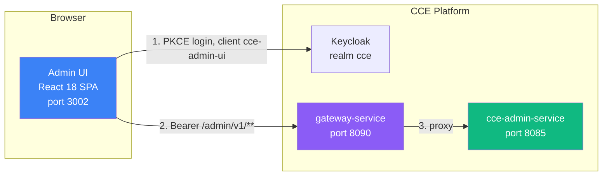
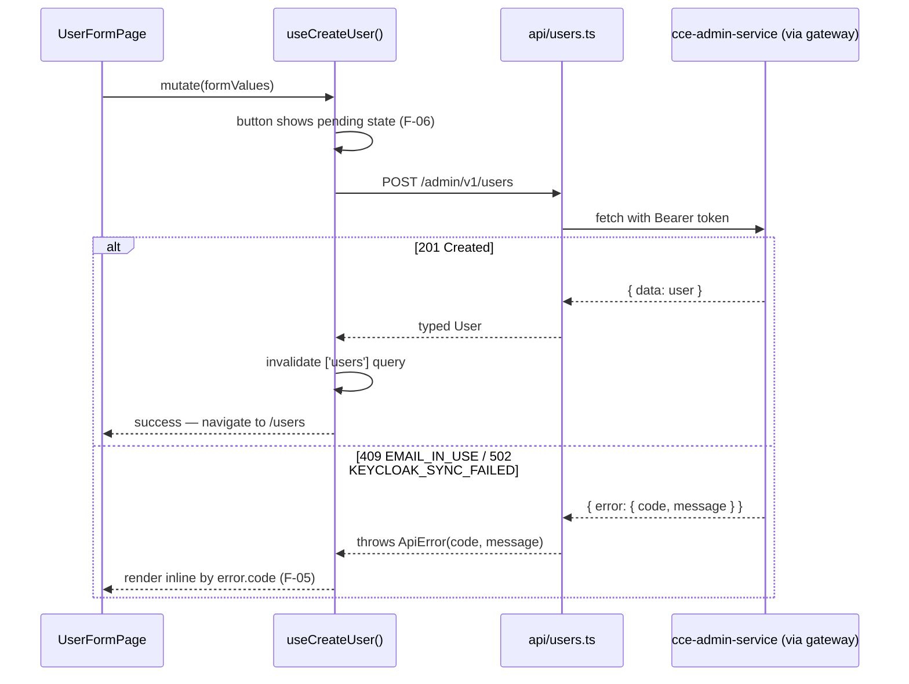

# Architecture Overview — Admin UI

> **CCE Admin UI** — Platform administration console (users, roles, menus, API permissions)
> **Status**: Design stage — no code yet.

Derived from `CCE_Admin_Module_PRD.pdf` §6, §8 and the sibling service's
[cce-admin-service/docs/architecture-overview.md](../../cce-admin-service/docs/architecture-overview.md),
which is the source of truth for the API this console calls. Where this document and that one
disagree, treat it as a bug in this document.

This console intentionally mirrors `cce-insights-ui`'s stack and conventions (same Keycloak PKCE
pattern, same TanStack Query usage, same Tailwind setup) since it's a peer console behind the same
`gateway-service` — see `cce-insights-ui/docs/architecture-overview.md` for the pattern this was
modeled on. The differences are deliberate, not oversights, and are called out explicitly below.

---

## 1. System Context



Unlike `cce-insights-ui`, authentication here is **mandatory**, not a build-time toggle — there is no
`VITE_AUTH_ENABLED=false` escape hatch (F-01). A platform administration console with no auth bypass
is a deliberate hardening choice, not an oversight; don't carry the insights-ui pattern over here.

## 2. Technology Stack

| Layer | Technology | Version | Notes vs. `cce-insights-ui` |
|---|---|---|---|
| Framework | React | 18.x | Same |
| Language | TypeScript | 5.x | Same |
| Build | Vite | 6.x | Same |
| Routing | React Router | 7.x | Same |
| Server state | TanStack Query | 5.x | Same — **no optimistic updates anywhere** (F-06), unlike patterns that assume client-side cache patching |
| Forms | React Hook Form 7 + Zod 3 | — | New — `cce-insights-ui` is read-only and has no forms |
| Tables | TanStack Table | 8.x | Same |
| Styling | Tailwind CSS | 4.x | Same |
| Icons | Heroicons | 2.x | Same |
| Dates | date-fns | 4.x | Same |
| Auth | `keycloak-js` 26, Authorization Code + PKCE (S256) | — | Same library; **mandatory**, own client id `cce-admin-ui`, `updateToken(70)` every 60s |
| Testing | Vitest + Testing Library + MSW | — | Same |
| Build/run | Docker: `node:20-alpine` build → `caddy:2-alpine` runtime, port `3002` | — | Same pattern, different port |

## 3. Application Architecture

```
main.tsx (initAuth() runs and resolves BEFORE render — F-01)
└── App.tsx (sidebar from GET /me/menus?console=ADMIN + header from GET /me — Milestone 7, reverses F-03)
    ├── /users           → UsersListPage        (F-10)
    ├── /users/new       → UserFormPage (create) (F-11)
    ├── /users/:id       → UserFormPage (edit)    (F-11)
    ├── /roles           → RolesListPage          (F-12)
    ├── /roles/:id       → RoleDetailPage
    │   ├── Menus tab       (F-13)
    │   └── Permissions tab (F-14)
    ├── /menus           → MenusCatalogPage      (F-15)
    ├── /protocols       → ProtocolsListPage      (Milestone 8)
    ├── /protocols/new   → ProtocolUploadPage     (Milestone 8)
    └── /protocols/:id   → ProtocolDetailPage     (Milestone 8: view, retire)
```

### Why the sidebar is driven by the API (Milestone 7 — this reversed the earlier static sidebar, F-03)

> **Milestone 7 reversed the old decision** (F-03: a static Users / Roles / Menus sidebar, a user without
> permission "still sees the link and gets an inline 403"). The sidebar is now built from
> `GET /me/menus?console=ADMIN`, and a tab the user can't use is not shown. This is what lets a role that
> carries only the Protocols tab see only that tab. See
> [cce-admin-service architecture-overview.md §9.9](../../cce-admin-service/docs/architecture-overview.md#99-milestones-78--role-aware-console-and-protocol-management).

`App.tsx` calls `useAdminMenus()` (`GET /me/menus?console=ADMIN`) and:

- renders the returned tabs as the sidebar, in the API's order; a tab this build has no screen for is not shown;
- renders a route only for tabs the user has; any other URL (and `/`) redirects to the first allowed tab, which is
  the landing page;
- shows a **"no access"** screen (with Sign out) when the user has no tab — or when the call answers `403`;
- shows an **error with Retry** when the call fails otherwise, never a wrong or empty-looking sidebar;
- re-checks on window focus, so a tab another admin just added or took away appears without a manual reload
  (the service reads the user's database roles on every call, so there is no token-refresh lag).

Hiding a tab is convenience, not security: `cce-admin-service` refuses every management endpoint to anyone but
`SUPER_ADMIN` on its own, and `api_permissions` is still enforced at the gateway. A direct inline `403` (F-04)
remains the answer for an action a user reaches but may not perform.

### Layer responsibilities

| Layer | Responsibility | Rule |
|---|---|---|
| `pages/` | Route-level components | Compose `hooks/` + `components/`; never call `api/` directly (F-01–F-06) |
| `components/` | Visual rendering | Stateless where possible |
| `hooks/` | TanStack Query wrappers | One hook per API endpoint group; return `{ data, isLoading, error }` |
| `api/` | Typed `fetch` wrapper (`client.ts`) + one module per resource | No React dependencies; unwraps the `{data, pagination?}` / `{error:{code,message}}` envelope into `ApiError`. `protocolClient.ts` is the second wrapper (Milestone 8): `cce-protocol-service` is called **through the gateway** at `/v1/protocol`, with a different, un-enveloped body, so it maps the status (not the body) into `ApiError` |
| `auth/` | `keycloak-js` init, token refresh, context | `initAuth()` blocks render (F-01) |
| `schemas/` | Zod schemas | Mirror backend validation (UPPER_SNAKE_CASE role names, email format, required fields) so a client-side error surfaces before a round trip, but server errors by `error.code` still render (milestone note) |
| `context/` | Current-user context from `GET /me` | Populates the header; the sidebar comes from `hooks/useAdminMenus.ts` (`GET /me/menus?console=ADMIN`, Milestone 7) |

## 4. Data Flow — Mutation Lifecycle



**No optimistic updates anywhere (F-06).** Every mutation waits for the server and invalidates the
relevant query on success rather than patching the cache client-side. Writes fan out to Keycloak and
the gateway and can fail midway (see the admin-service's
[consistency model](../../cce-admin-service/docs/architecture-overview.md#7-consistency-model)) — an
optimistic UI would show success for a request that then partially failed server-side.

### `KEYCLOAK_SYNC_FAILED` gets its own component (F-05)

A `502 KEYCLOAK_SYNC_FAILED` must never render as a generic error toast — it needs its own message
explaining what survived and the next step. What survived differs by operation, so the one shared
component (`SyncFailedNotice`, not duplicated — milestone note, F-11/F-14) has two wordings:

| `variant` | Used by | Meaning | Offers |
|---|---|---|---|
| `saved` (default) | Role Detail → Permissions tab | The edit **is** stored; only Keycloak is behind | **Re-sync** button |
| `not-saved` | User-create form | The whole creation was **rolled back**; nothing was stored | Nothing to re-sync — submit the form again |

Saying "your change was saved" after a rolled-back user creation would be false, hence the second
wording rather than reusing the first.

## 5. Error Handling

| HTTP Status | UI Behavior |
|---|---|
| `400 VALIDATION_ERROR` | Inline field errors (Zod mirrors server rules, but server errors still win by `error.code`) |
| `401 UNAUTHENTICATED` | Handled by the auth layer — token refresh or re-login, not a page-level error |
| `403 FORBIDDEN` | Shown **inline on the screen that made the call** (F-04) — never a global error page, since a role may be allowed to view a list but not a specific action on it |
| `404 USER_NOT_FOUND` / `ROLE_NOT_FOUND` / `MENU_NOT_FOUND` | "Not found" empty state on the detail page |
| `409 DUPLICATE_ROLE_NAME` / `DUPLICATE_MENU_KEY` / `EMAIL_IN_USE` / `ROLE_IN_USE` / `SYSTEM_ROLE_IMMUTABLE` | Inline, next to the field or action that caused it |
| `502 KEYCLOAK_SYNC_FAILED` | Distinct component (§4) — never a generic toast |

## 6. State Management

| State type | Tool | Examples |
|---|---|---|
| Server state | TanStack Query | Users, roles, menus, permissions — all server-owned, no client mutation of cached data |
| Form state | React Hook Form + Zod | Create/edit forms |
| Current user | Context, from `GET /me` | Header display only — does **not** drive sidebar visibility (§3). Header states: loading; signed in as `username (ROLE, …)` or `(no roles)`; `403` → "Your account has no access to the admin console" (Keycloak login worked, but there is no local `ACTIVE` user); any other error → "Could not load your profile" |
| UI state | `useState` | Active tab (Menus/Permissions), selected rows |

### Query key strategy

```typescript
['users', { status, roleId, facilityScope, q, page, pageSize }]
['users', userId]
['roles']
['roles', roleId]
['roles', roleId, 'menus']
['roles', roleId, 'permissions']
['menus']
['me']
```

A role's Menus and Permissions tabs are **separate query keys** (not one combined "role detail"
fetch) — the two axes are independently editable and independently saved
([cce-admin-service architecture §2](../../cce-admin-service/docs/architecture-overview.md#2-why-two-independent-axes)),
so their caches should invalidate independently too.

## 7. Routing

```tsx
<Routes>
  <Route path="/users" element={<UsersListPage />} />
  <Route path="/users/new" element={<UserFormPage mode="create" />} />
  <Route path="/users/:id" element={<UserFormPage mode="edit" />} />
  <Route path="/roles" element={<RolesListPage />} />
  <Route path="/roles/:id" element={<RoleDetailPage />} />
  <Route path="/menus" element={<MenusCatalogPage />} />
</Routes>
```

Sidebar (Milestone 7): built from `GET /me/menus?console=ADMIN` — **Users**, **Roles**, **Menus**,
**Protocols** for a `SUPER_ADMIN`, only the entries a role carries for anyone else (see §3). What a user can
actually *do* on a screen they reach is still governed by `api_permissions`, surfaced as inline `403`s.

## 8. Deployment

Docker build-time `VITE_*` args (same pattern as `cce-insights-ui`) — see
[deployment-guide.md](deployment-guide.md). Each environment needs its own image build.

### Protocols (Milestone 8)

`/protocols` calls `cce-protocol-service` **directly through the gateway** with the user's own token — there is no
`cce-admin-service` endpoint in between, so the gateway's route and the role's permission rows are the only gate
(see [cce-admin-service architecture-overview.md §9.9](../../cce-admin-service/docs/architecture-overview.md#99-milestones-78--role-aware-console-and-protocol-management)).
`api/protocolClient.ts` therefore decides by HTTP status: three different things can answer (the protocol
service, the gateway's permission `403`, the gateway's *empty* `403` for a CORS-refused origin, and the gateway's bare
`500` when the protocol service is down), and
`lib/protocolErrors.ts` turns them into one plain sentence each (`forbidden`, `unavailable`, `duplicate`,
`rejected`, …). The upload's pre-flight checks live in `lib/planDefinition.ts` and run before any request.
